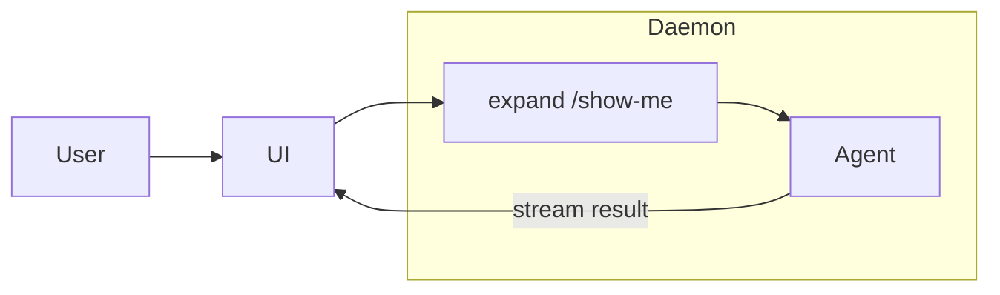
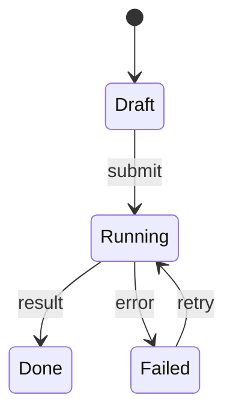
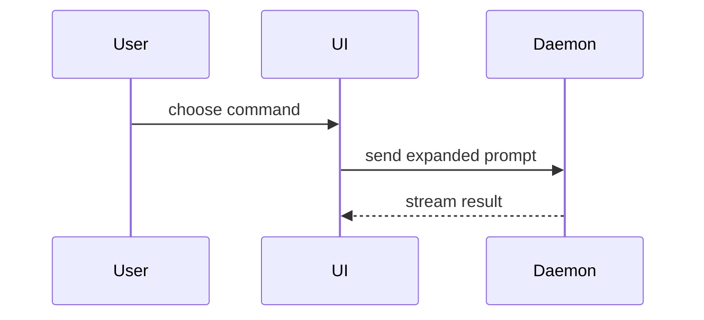
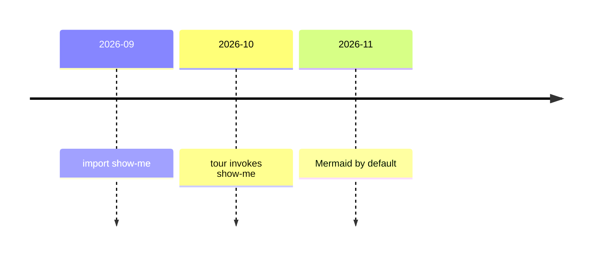
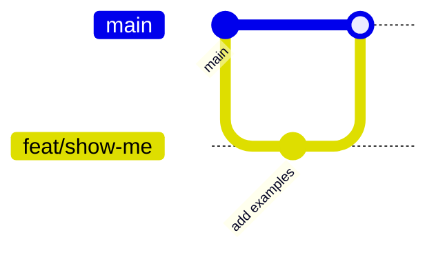
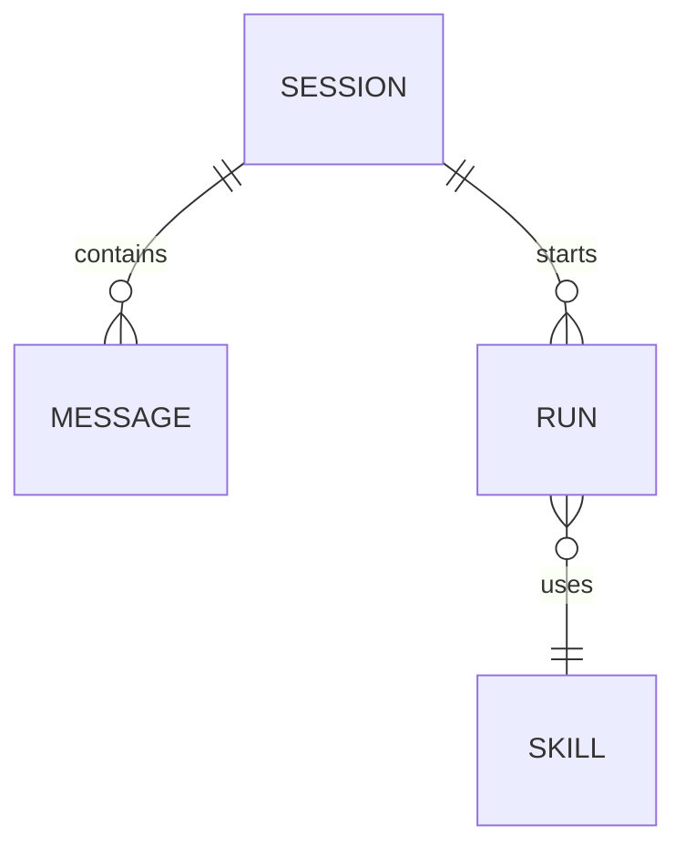

Help the user understand the current topic of conversation visually. Skip the preamble and keep prose brief. Pick the smallest view that makes the key point clear.

- Show logic or an algorithm as pseudocode:

```text
on(save)
  if content is unchanged
    return cached result
  write new content
  return fresh result
```

- Show which functions call which as a call tree:

```text
submitForm
  createSession
    persistPrompt
    launchAgent
  navigateToSession
```

- Show UI structure as a component tree, including state and module boundaries that matter:

```tsx
<SessionPage> (apps/example/src/routes/session.tsx)
  useSessionEvents()
  <SessionToolbar>
    <RunSkillButton> (packages/ui)
```

- Show file responsibility or a broad refactor as a shallow file tree:

```text
src/
├── commands/       # parses user actions
├── sessions/       # owns session state
└── transport/      # sends API requests
```

- Use Mermaid by default for relationships: branching control flow, data flow, component boundaries, state, interaction over time, chronology, branch history, and data models. Keep text trees, pseudocode, and diffs for code shape and changes. Keep each diagram to about 12 nodes, use real names from the topic, and quote labels that contain punctuation.

Show control flow, data flow, or component boundaries as a `flowchart`:



Show a lifecycle as a `stateDiagram-v2`:



Show interaction over time as a `sequenceDiagram`:



Show chronology as a `timeline`:



Show branch history as a `gitGraph`:



Show a data model as an `erDiagram`:



- Use `diff` when the point is what changes and the surrounding shape already exists. Match the diff shape to the topic.

For a component change:

```diff
 <SessionPage>
   useSessionEvents()
   <SessionToolbar>
+    <RunSkillButton />
   <SessionTimeline>
+    <SkillResultCard />
```

For a file-layout change:

```diff
 src/
 ├── commands/
+│   └── show-me.ts       # expands the slash command
 ├── sessions/
-└── transport.ts
+└── transport/
+    ├── client.ts
+    └── stream.ts
```

For a call-tree or call-stack change:

```diff
 submitForm
   createSession
     persistPrompt
+    expandSkillMention
     launchAgent
-  navigateToSession
+  navigateToSession
+    subscribeToEvents
```

For a state or control-flow change:

```diff
 on(save)
-  write content
+  if content is unchanged
+    return cached result
+  write new content
+  invalidate cache
```

- Show the whole block when most of it is new, when omitted context would hide ownership or order, or when the user needs a copyable target shape:

```ts
function expandSkill(command: string): string {
  const skillName = command.slice(1)
  return `use the ${skillName} skill`
}
```

- For a visual UI, layout, state comparison, or concept too dense for Mermaid, write one focused HTML file — a diagram, an infographic, or a short slide deck, whichever fits the point. Match the product's colors, type, spacing, and components; use real labels and data; support desktop and mobile. Render any diagram in it with Mermaid when remote resources are allowed: put the source in `<pre class="mermaid">`, escape `<` as `&lt;` and `&` as `&amp;`, and load the pinned build with `<script type="module">import mermaid from "https://cdn.jsdelivr.net/npm/mermaid@12.3.0/dist/mermaid.esm.min.mjs"; mermaid.initialize({ startOnLoad: true });</script>`. When the caller or environment forbids remote resources, draw the diagram as inline SVG instead. When a host reference documents a host-native private, shareable hosted page, publish the file there and give the user its link; when you revise a visual you already published in this conversation, update that page instead of creating another. Do not publish when the user asked for the file itself. On a host with no reference that offers its own hosted page, show the capability mapping, say it is untested, and publish only after the user confirms. Otherwise, or when publishing fails, open the file for the user with the host's viewer or the OS opener; if neither is available, give its path. Host references: [references/claude-code.md](references/claude-code.md).

### guidance

Place each visual next to the short text it supports. Keep only the calls, files, props, states, and boundaries needed to answer the user's current question or the options to resolve the current discussion point.

You may use one of these, you may use several, it is unlikely you will use all of them. Use your judgement and don't overwhelm the user.
